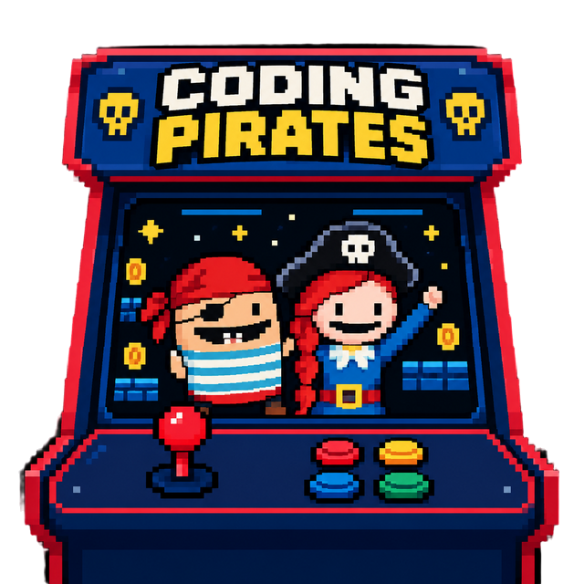

<div align="center">
	

	<h1>CODING PIRATES ARCADE</h1>

	<strong>Scratch games, packed for the arcade.</strong>

	<p>Turn public Scratch projects into standalone games, then bring them to your Pegasus-powered arcade.</p>
</div>

---

## What's in the chest?

```text
coding-pirates-arcade/
├── README.md                         # You are here
└── node-scratch-maker/               # Scratch packaging + student importer
    ├── web/                          # Importer UI and pirate assets
    │   └── assets/
    │       └── pirates_8bit_transparent.png
    ├── scripts/                      # CLI, importer server, Pegasus integration
    ├── locales/                      # English and Danish translations
    ├── browser-tests/                # Importer browser tests
    ├── package.json                  # Commands and dependencies
    └── README.md                     # Setup, configuration, and usage guide
```

## Set sail

The toolkit lives in [`node-scratch-maker`](node-scratch-maker/README.md). Follow its guide for setup, packaging Scratch projects, configuring the student importer, and building a portable release.